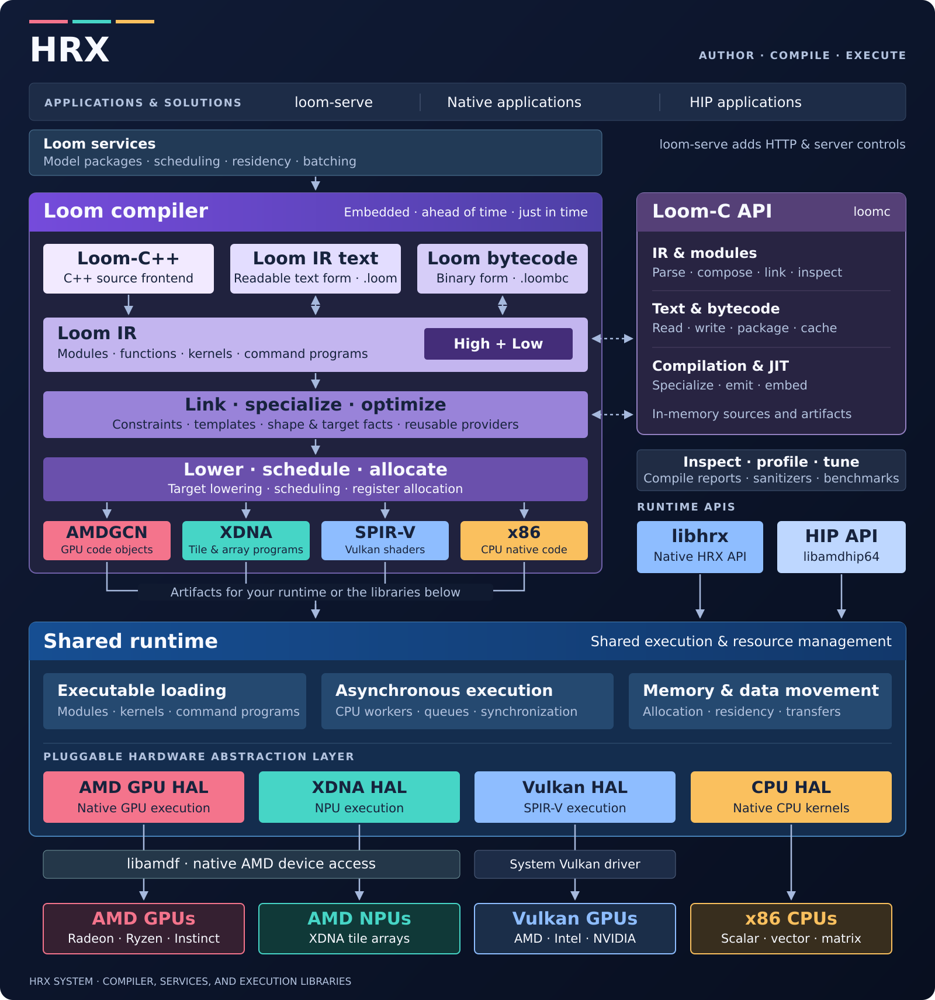

# HRX System

**[Documentation](https://rocm.github.io/hrx-system/loom/) ·
[Get the SDK](https://rocm.github.io/hrx-system/loom/getting-started/acquiring-loom/) ·
[Build from source](BUILDING.md)**

[Loom](loom/) is a language and compiler for native programs on CPUs, GPUs, and NPUs.
Its microsecond-scale JIT, runtime, and inference server fit in a megabyte-scale
SDK, with no LLVM or ROCm dependency.
[LibHRX](libhrx/) is a C API for graph-based heterogeneous compute with an optional
[HIP compatibility layer](libhrx/src/binding/hip/).

This repository contains the compiler, execution libraries, native AMD device
support, and `loom-serve`: an inference engine that hosts multiple models and
modalities together. The pieces can be embedded independently, from compiling
one program for an existing runtime to running a shared model server.

> [!TIP]
> **To run models or troubleshoot a model, start at [loom-dev](https://loom-fun.github.io/loom-dev/).**
> [Loom skills](https://github.com/loom-fun/loom-skills) help your agent set up,
> run, and adapt models; the [Loom docs](https://rocm.github.io/hrx-system/loom/)
> cover installation, serving, and authoring.
>
> `hrx-system` is the engineering repository for Loom's compiler, runtime, and tools.

<!-- Keep adjacent GitHub alerts as separate blockquotes. -->

> [!NOTE]
> This is a tech preview. Interfaces and target coverage are evolving; see the
> [target guide](https://rocm.github.io/hrx-system/loom/targets/) for current
> support. The project is not an official component of the ROCm stack.

This project has been engineered with the assistance of agents.

## How it fits together

Programs can be written in a [subset of C++](https://rocm.github.io/hrx-system/loom/getting-started/first-kernel/#write-the-same-kernel-in-cpp)
or directly in [Loom IR](https://rocm.github.io/hrx-system/loom/getting-started/first-kernel/#create-one-source-file).
Functions, kernels, command programs, and pipelines share a compiler that can
link and specialize them using shapes, configuration, and target capabilities.
The same compiler runs ahead of time or inside an application. Kernels compile
in microseconds to milliseconds, making specialization practical when the
application has the information it needs.

[Model packages](https://rocm.github.io/hrx-system/loom/serving/model-documents/)
bundle source or bytecode, weights, and a JSON descriptor. The model supplies its
implementation; Loom services provide execution, batching, residency, and
scheduling, with `loom-serve` adding HTTP endpoints and server controls. Models
can share a process and its resources, and implementations can be changed while
the server is running. Adding a model means supplying a program to the platform.

The compiler emits ELF, HSACO, SPIR-V, WebAssembly, and other artifacts. An
application can load that output through its own runtime, or use the execution
libraries here. The shared HAL provides CPU execution, Vulkan execution, and
native AMD GPU and XDNA execution. Native AMD access uses `libamdf` and the OS
drivers; it does not require a ROCm SDK or ROCr installation. Vulkan uses the
system's Vulkan implementation.

These boundaries keep model behavior out of the compiler and hardware layers.
A new implementation can reuse the surrounding software, and an improvement to
the compiler or runtime can benefit the programs already using it. `libhrx` is
another client of the shared runtime, exposing a native HRX API and a HIP
compatibility binding. Loom's compiler and services use the runtime directly.

## Find your way around

| Package | What lives here |
| --- | --- |
| [Loom](loom/README.md) | Language, compiler, public compiler C API, tools, model execution, serving, and SDK packaging. Start here for Loom development. |
| [Shared runtime](runtime/README.md) | HAL, VM, CPU task system, asynchronous I/O, networking, storage, and tokenization. |
| [libamdf](libamdf/README.md) | Native AMD GPU and NPU access: device capabilities, memory backing, queues, and OS integration. |
| [libhrx](libhrx/README.md) | Native HRX API, HIP compatibility, conformance tests, and package installation. |
| [Hardware reference](docs/reference/amd/README.md) | AMD GPU and NPU programming contracts and execution mechanisms. |
| [Build tools](BUILDING.md) | Source setup, Bazel and CMake workflows, dependency configuration, tests, and embedding. |

The shared runtime grew from [IREE](https://github.com/iree-org/iree), which
explains the `iree/` source paths and API names. Its current contracts live beside
the implementation in this repository.

## Build on it

The [Loom library](https://github.com/ROCm/hrx-loom-library) is the home for
reusable model programs, kernels, and their tests. Community efforts such as
[loom-fun's models](https://huggingface.co/loom-fun) and
[authoring skills](https://github.com/loom-fun/loom-skills) show how that corpus
can grow independently of the compiler and server.

For changes to the core, start with [Building](BUILDING.md) and
[Contributing](CONTRIBUTING.md), then the README, headers, and tests nearest the
component you are changing. Model ports and experiments belong with their model
sources; fixes and capabilities that other programs can reuse belong in the
compiler, runtime, or shared libraries.

See [Security](SECURITY.md) for reporting vulnerabilities and
[LICENSE](LICENSE) for the Apache 2.0 license with LLVM exceptions. Individual
third-party components and assets retain their own license notices.
