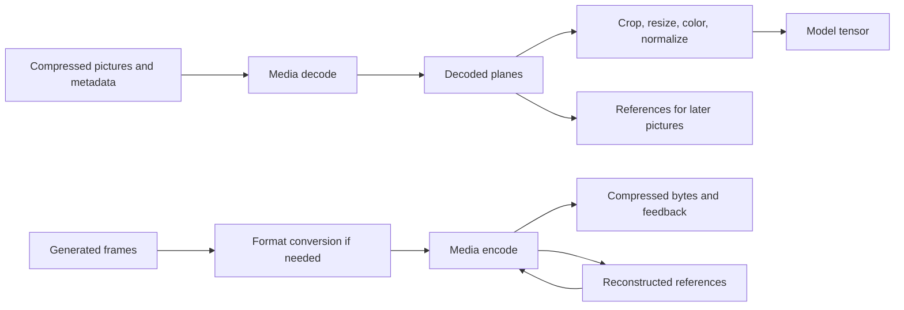

# Media engines

AMD's media engines decode compressed images and video into GPU-addressable
surfaces and encode generated frames into compressed streams. A resident
pipeline couples these engines to compute through surface layouts, native
dependencies, and resource lifetimes. The media engines perform entropy coding
and reconstruction; callers manage stream parsing, reference pictures, and
surface storage.

| Programming task | Reference |
| --- | --- |
| Decode independent JPEG/MJPEG pictures | [JPEG commands, registers, and Linux submission](media/jpeg.md). |
| Decode a video stream | [VCN decode messages, sessions, reference pictures, and output](media/video-decode.md). |
| Encode generated or processed frames | [VCN encode tasks, rate control, reconstruction, and feedback](media/video-encode.md). |
| Use Windows video and compute together | [D3D Video, AMF, resource/fence sharing, and the native boundary](media/windows.md). |

The chapters follow immutable Mesa/Linux builders and their callers. Their
generation predicates describe those implementations; actual device/firmware
queries determine admission. Throughput, numerical equivalence, and
cross-runtime handoff require hardware qualification beyond these command and
ownership contracts.

## Engine and capability discovery

Video Core Next (VCN) includes distinct JPEG and video command paths:

| Work | Native engine and protocol | Persistent picture state |
| --- | --- | --- |
| JPEG/MJPEG decode | `AMD_IP_VCN_JPEG`; `PACKETJ` register pairs | No GPU session or reference-picture buffer in Mesa's JPEG decoder. |
| AVC/H.264, HEVC/H.265, VP9, AV1 decode | `AMD_IP_VCN_DEC` before VCN 4; unified video through `AMD_IP_VCN_ENC` from VCN 4 | Session/context storage, codec metadata, and decoded reference pictures. |
| AVC/H.264, HEVC/H.265, AV1 encode | `AMD_IP_VCN_ENC`; encode firmware tasks | Session/rate-control state, reconstructed references, bitstream output, and feedback. |
| Scaling and color processing | Shader work or a separately admitted video-processing path, including `AMD_IP_VPE` where present | Input/output surfaces and processing state. |

Mesa aliases the unified video engine as `AMD_IP_VCN_UNIFIED` and uses `VCN_ENC`
for unified decode, including on the **decode-only VCN 4.0.3, 5.0.1, and 5.0.2**.
JPEG remains separate. The codec table includes generation-dependent MPEG-2
and VC-1 decode, and no PNG or WebP decode. [Engine identities][mesa-engine-names],
[decode-only selection][decode-only], [queue admission][queue-caps],
[codec table][video-caps].

Linux discovery combines several inputs:

| Query or identity | Information it establishes |
| --- | --- |
| `AMDGPU_INFO_HW_IP_INFO` | Available logical rings, native/discovery IP version, and IB alignment for the requested engine. |
| `AMDGPU_INFO_HW_IP_COUNT` | Driver-reported IP count; the cited JPEG path counts instances multiplied by rings. Legal submission rings come from `AMDGPU_INFO_HW_IP_INFO`. |
| VCN firmware version | Admission of features such as memory writes, reference layouts, and rate-control modes. |
| `AMDGPU_INFO_VIDEO_CAPS` decode/encode queries | Per-codec validity and dimensional limits reported by the kernel. |
| API profile/format queries | Whether the selected frontend and driver expose the requested codec configuration and storage. |

Mesa first builds its generation-specific capability table, then intersects
codec validity with successful kernel video-capability queries and replaces
the width/height limits with the returned values.
[Native discovery][linux-discovery], [IP counts][linux-count],
[kernel capability reconciliation][kernel-video-caps],
[firmware feature predicates][video-firmware].

The cited Linux VCN 4.0 driver can restrict an AV1 session to instance 0;
switching the scheduler waits for that entity's outstanding work. H.264, HEVC,
and VP9 creation messages are exempt from that restriction.
[Instance selection and session inspection][linux-video-routing].

## What crosses the media/compute boundary

A frame handoff carries:

| Information | Owner and purpose |
| --- | --- |
| Native allocation identities and mappings | Establish residency and addressability in each submitting context. |
| Format, bit depth, plane offsets/pitches, tiling, and metadata layout | Let the next engine interpret the same bytes correctly. |
| Coded extent, visible crop, chroma siting, range, matrix, and transfer characteristics | Define the pixels and their conversion into a model tensor or encoded image. |
| Producer dependency and memory visibility | Order use and make writes visible through the consumer's memory path. |
| Reference slots and presentation order | Preserve codec state independently of which frames the application consumes. |
| Terminal status and all final users | Determine when storage can be reused or destroyed. |

Mesa's [surface representation][video-surfaces],
[decode resource binding][video-decode-buffers], and
[encode resource binding][video-encode-resources] carry different parts of
this information. The caller handles container demuxing, supplies codec picture
metadata, and chooses the model's frame-sampling policy. rocDecode exposes
separate sequence, decode-order, and display-order parser callbacks, while its
demux utility uses the container layer separately.
[Parser contract][rocdecode-parser], [demux caller][rocdecode-demux].

For example, a stream with presentation order `I0 B1 B2 P3` may submit
`I0 P3 B1 B2` so the B pictures can reference P3. Sampling only B2 for a model
can remove preprocessing of the other pictures; it cannot discard pictures
needed to reconstruct B2. Independent streams provide parallel work without
violating these reference dependencies.

## Resident input and output flows

An input pipeline submits decode after compressed input and required reference
pictures are ready. Compute waits on decode, samples the native planes, and
writes the final tensor. It can combine crop, resize, color conversion, and
normalization without first writing a full RGB image. The output surface stays
live until both compute and the codec's reference users finish. If output and
reference storage are distinct, each has its own lifetime. AV1 film grain can
require separate reference and displayed pictures even when a shared layout
is otherwise possible. [Reference layouts and film grain](media/video-decode.md#reference-storage-and-output).

In the reverse direction, a model or conversion kernel publishes a supported
encoder input surface. Encode waits on that producer, reads input and prior
reconstructions, and writes compressed output, a new reconstruction, and
feedback. Input can be recycled after its final encode read; reconstruction
survives until later pictures stop referencing it; compressed output survives
until the transport or file consumer finishes. Feedback supplies the encoded
byte count and codec status after completion.
[Encoder task and output contracts](media/video-encode.md).

Backpressure follows these ownership boundaries. More queued frames require
more live input/output storage alongside retained codec references.
A format change creates a new layout/session requirement; old mappings remain
live through accepted work and outstanding consumers. Stream drain includes
delayed presentation/output as well as device completion.
[Sequence-change callbacks][rocdecode-parser],
[reconfiguration resource replacement][rocdecode-reconfigure],
[encoder lifetime](media/windows.md#encoding).

## Native dependencies and completion

For Linux DRM jobs, syncobj wait/signal chunks order submissions without an
application completion wait. Unresolved dependencies between different engine
schedulers install kernel callbacks that wake the consumer scheduler. This
removes a CPU wait in the application but retains driver participation.
[DRM dependencies][linux-dependencies],
[scheduler dependency handling][linux-scheduler-dependencies].

The memory-write capabilities differ materially between media paths:

| Path | Source-established completion mechanism |
| --- | --- |
| JPEG | Native job/syncobj fences. Mesa advertises no arbitrary memory-write operation; the cited user IB parser excludes the kernel's fence packets. |
| VCN video | Native job/syncobj fences, plus firmware-gated user-command memory writes on supported versions. Mesa uses these writes for video events. |
| D3D12 video | Queue `Signal`/`Wait`, resource-state transitions, and codec feedback/query results. |

Mesa's VCN write-memory emitter writes a **32-bit value**, despite taking a
64-bit value argument. Before unified VCN it uses the decode register command;
on the encode/unified path it uses common package `0x33000001`. Mesa advertises
`AC_VIDEO_WRITE_MEMORY_SUPPORT_PCIE_ATOMICS` at VCN 2/3/4 encoder firmware
minor versions 24/33/22 respectively, and on VCN 5. RADV uses the operation for
events whose allocations bypass GL2 and retain a native BO. Visibility depends
on the allocation's mapping and the consumer's memory path; native job status
supplies error and retirement information.
[Capability selection][video-firmware],
[memory-write and timestamp emitters][video-common-commands],
[event caller][video-event], [event storage][video-event-storage].

On `AMD_IP_VCN_ENC`, each common operation has a 16-byte `ENGINE_INFO`
envelope selecting engine type `1`, followed by one sized package:

| Operation | Package representation, in DWORD order | Total with envelope |
| --- | --- | ---: |
| Write memory | `20`, `0x33000001`, destination address low, address high, 32-bit data | 36 bytes |
| Timestamp | `16`, `0x31000001`, destination address low, address high | 32 bytes |

The first word is the inner package size in bytes. These address fields are
low then high, unlike the high/low fields of the unified decode-buffer package.
The envelope's extent includes both itself and the inner package. The emitter
registers no operands by itself; its caller retains/adds the destination BO.
[Common structures][video-common-layout], [envelope builder][vcn-envelope],
[event caller][video-event].

Linux's VCN 4 unified ring also sets `no_user_fence`. That prohibits the DRM
user-fence chunk, not the separately admitted firmware memory-write operation
or native job fence. The kernel still owns VM setup, ring execution,
completion interrupts, and media power transitions.
[VCN ring contract][linux-video-ring], [power ownership][linux-video-power].

Crossing into a different compute transport requires a supported dependency
import or another qualified device-visible protocol. The DRM user-queue wait
ioctl returns address/value pairs for its own user-queue fences, but CPU-waits
on other fence types, including ordinary kernel-scheduled media jobs.
Importing a DMA-BUF establishes neither that dependency nor equal GPU virtual
addresses.
[User-queue wait conversion][linux-userq-wait],
[external memory and synchronization](../interop/external-memory.md).

## Existing sharing implementations

rocJPEG exports VA surfaces as `DRM_PRIME_2` and imports/maps their backing
memory into HIP, retaining pitches and offsets. Its reuse option caches those
imports per pooled surface; the build defaults it on, with a version check
disabling it for detected ROCm releases older than 7. Its batched finalizer
still waits for each VA surface, copies/converts into caller output, and
synchronizes the HIP stream before releasing a sub-batch.
[Cached mapping][rocjpeg-interop], [build selection][rocjpeg-interop-build],
[finalization][rocjpeg-finalize].

On Linux, rocDecode's `GetVideoFrame` waits for VA completion, caches the
external-memory mapping, and returns plane pointers directly into it.
On Windows, its corresponding path copies the tiled D3D12 surface into a linear
staging buffer each frame, waits for that copy, and caches the staging buffer's
HIP import. Both paths reuse their imports across frames; their per-frame costs
include dependency waits and, on Windows, the staging copy.
[Linux and Windows frame mapping][rocdecode-interop],
[Windows staging and wait][rocdecode-staging].

## Memory and traffic

For tightly packed even dimensions, 8-bit NV12 occupies `1.5 × width × height`
bytes; P010 uses 16-bit storage for its 10-bit samples and occupies
`3 × width × height`. Actual allocation uses pitches, aligned heights, tiling,
and any auxiliary metadata. The following are **logical pixel-storage counts**,
not allocator results or measurements:

| Frame | NV12 | P010 | RGBA8 |
| --- | ---: | ---: | ---: |
| 1920 × 1080 | 2.97 MiB | 5.93 MiB | 7.91 MiB |
| 3840 × 2160 | 11.87 MiB | 23.73 MiB | 31.64 MiB |

One extra full-frame 4K NV12 copy adds 11.87 MiB of live destination storage
and logically reads plus writes **23.73 MiB per frame**. At 60 frames/s that
is **1.49 GB/s** of logical copy traffic, before conversion or model traffic.
The analogous P010 copy is 2.99 GB/s. Cache behavior and physical traffic need
measurement; these counts identify avoidable work, not achievable bandwidth.

The complete live set is the union of compressed input/output pools, session
and codec scratch, reference pictures, consumer-held pictures, command and
feedback storage, and model tensors. Counting a coincident output/reference
allocation twice overstates it; omitting separate DPB or delayed consumers
understates it. Three additional 4K NV12 consumer slots alone require about
35.60 MiB before alignment.

Video scratch can be significant independently of those pictures. Mesa's
decoder has a 128 KiB session prefix plus codec-specific context. Its AV1
context calculation contains **33.47 MiB** of fixed scratch terms before
probability contexts and other scratch are added. This is a source-derived
term in that implementation, not an unavoidable minimum for every VCN/API.
The encoder adds reconstruction and optional pre-encode analysis storage;
quality settings can therefore change both traffic and capacity.
[Decode context sizing][decode-context-size], [AV1 sizing][av1-context-size],
[encoder DPB and pre-encode sizing][encode-dpb-size].

## Processing and numerical contracts

Color range, matrix, transfer function, and chroma siting accompany the
NV12/P010 layout. A model pipeline needs those facts plus its resize filter,
antialiasing, crop convention, and normalization. Direct plane sampling can
remove intermediate images only when it preserves that numerical contract.
An encoder's RGB conversion is similarly a specific admitted operation:
Mesa's encode-format-conversion path rejects scaling, nonzero crop origins,
rotation/blending, and DCC-compressed input, among other restrictions.
[Encoder conversion admission][encode-conversion].

VPE is a separate processing engine with its own capability table, including
generation-specific formats and rotation/blending. Windows exposes video
processing and motion-estimation APIs separately from decode and encode.
[VPE capabilities][vpe-caps],
[Windows processing interfaces](media/windows.md#processing-and-sharing).

## Timing boundaries

Mesa advertises timestamp operations for its `VCN_ENC` queue from VCN 2,
including the unified decode path from VCN 4. It does not set that capability
on the older dedicated decode or JPEG queue. RADV reports 64 valid bits for
an admitted video timestamp queue and emits the common timestamp operation
into that queue. Its public timestamp period is
`1,000,000 / clock_crystal_freq` nanoseconds, with crystal frequency in kHz;
raw values are not host-clock nanoseconds.
[Queue capability][queue-caps], [timestamp caller][video-timestamp-caller],
[valid bits][video-timestamp-bits], [period conversion][video-timestamp-period].

Performance comparisons consequently need the same accepted stream/profile,
consumer output, live-picture count, and completion boundary. Decode-only
timestamps omit parsing, dependency transitions, layout conversion, and tensor
production. Encoding comparisons also hold bitrate, quality, GOP/reference
policy, and buffering delay fixed.

[mesa-engine-names]: https://gitlab.freedesktop.org/mesa/mesa/-/blob/0ba4b08edc65075e9346d20d5310261939aaaf48/src/amd/common/amd_family.h#L160-178
[decode-only]: https://gitlab.freedesktop.org/mesa/mesa/-/blob/0ba4b08edc65075e9346d20d5310261939aaaf48/src/amd/common/ac_video.c#L18-23
[queue-caps]: https://gitlab.freedesktop.org/mesa/mesa/-/blob/0ba4b08edc65075e9346d20d5310261939aaaf48/src/amd/common/ac_video.c#L613-660
[video-caps]: https://gitlab.freedesktop.org/mesa/mesa/-/blob/0ba4b08edc65075e9346d20d5310261939aaaf48/src/amd/common/ac_video.c#L270-536
[linux-discovery]: https://github.com/torvalds/linux/blob/50d05c7c76c96b90462f24debacca971d2e86713/drivers/gpu/drm/amd/amdgpu/amdgpu_kms.c#L557-L634
[linux-count]: https://github.com/torvalds/linux/blob/50d05c7c76c96b90462f24debacca971d2e86713/drivers/gpu/drm/amd/amdgpu/amdgpu_kms.c#L712-L759
[kernel-video-caps]: https://gitlab.freedesktop.org/mesa/mesa/-/blob/0ba4b08edc65075e9346d20d5310261939aaaf48/src/amd/common/ac_video.c#L670-719
[video-firmware]: https://gitlab.freedesktop.org/mesa/mesa/-/blob/0ba4b08edc65075e9346d20d5310261939aaaf48/src/amd/common/ac_video.c#L11-119
[linux-video-routing]: https://github.com/torvalds/linux/blob/50d05c7c76c96b90462f24debacca971d2e86713/drivers/gpu/drm/amd/amdgpu/vcn_v4_0.c#L1800-L1981
[video-surfaces]: https://gitlab.freedesktop.org/mesa/mesa/-/blob/0ba4b08edc65075e9346d20d5310261939aaaf48/src/amd/common/ac_video.h#L39-46
[video-decode-buffers]: https://gitlab.freedesktop.org/mesa/mesa/-/blob/0ba4b08edc65075e9346d20d5310261939aaaf48/src/amd/common/ac_vcn_dec.c#L2182-2214
[video-encode-resources]: https://gitlab.freedesktop.org/mesa/mesa/-/blob/0ba4b08edc65075e9346d20d5310261939aaaf48/src/gallium/drivers/radeonsi/mm/radeon_vcn_enc.c#L1630-1712
[rocdecode-parser]: https://github.com/ROCm/rocm-systems/blob/b679bae80581b21a864a858fb0c85c3fb991991a/projects/rocdecode/api/rocdecode/rocparser.h#L243-L285
[rocdecode-demux]: https://github.com/ROCm/rocm-systems/blob/b679bae80581b21a864a858fb0c85c3fb991991a/projects/rocdecode/utils/video_demuxer.h#L25-L31
[rocdecode-reconfigure]: https://github.com/ROCm/rocm-systems/blob/b679bae80581b21a864a858fb0c85c3fb991991a/projects/rocdecode/src/rocdecode/roc_decoder.cpp#L97-L121
[linux-dependencies]: https://github.com/torvalds/linux/blob/50d05c7c76c96b90462f24debacca971d2e86713/drivers/gpu/drm/amd/amdgpu/amdgpu_cs.c#L645-L664
[linux-scheduler-dependencies]: https://github.com/torvalds/linux/blob/50d05c7c76c96b90462f24debacca971d2e86713/drivers/gpu/drm/scheduler/sched_entity.c#L465-L508
[video-common-commands]: https://gitlab.freedesktop.org/mesa/mesa/-/blob/0ba4b08edc65075e9346d20d5310261939aaaf48/src/amd/common/ac_cmdbuf_video.c#L12-68
[video-event]: https://gitlab.freedesktop.org/mesa/mesa/-/blob/0ba4b08edc65075e9346d20d5310261939aaaf48/src/amd/vulkan/radv_cmd_buffer.c#L16417-16431
[video-event-storage]: https://gitlab.freedesktop.org/mesa/mesa/-/blob/0ba4b08edc65075e9346d20d5310261939aaaf48/src/amd/vulkan/radv_event.c#L45-71
[video-common-layout]: https://gitlab.freedesktop.org/mesa/mesa/-/blob/0ba4b08edc65075e9346d20d5310261939aaaf48/src/amd/common/ac_vcn.h#L51-65
[vcn-envelope]: https://gitlab.freedesktop.org/mesa/mesa/-/blob/0ba4b08edc65075e9346d20d5310261939aaaf48/src/amd/common/ac_vcn.c#L10-31
[linux-video-ring]: https://github.com/torvalds/linux/blob/50d05c7c76c96b90462f24debacca971d2e86713/drivers/gpu/drm/amd/amdgpu/vcn_v4_0.c#L2002-L2033
[linux-video-power]: https://github.com/torvalds/linux/blob/50d05c7c76c96b90462f24debacca971d2e86713/drivers/gpu/drm/amd/amdgpu/amdgpu_vcn.c#L504-L552
[linux-userq-wait]: https://github.com/torvalds/linux/blob/50d05c7c76c96b90462f24debacca971d2e86713/drivers/gpu/drm/amd/amdgpu/amdgpu_userq_fence.c#L838-L887
[rocjpeg-interop]: https://github.com/ROCm/rocm-systems/blob/b679bae80581b21a864a858fb0c85c3fb991991a/projects/rocjpeg/src/rocjpeg_vaapi_decoder.cpp#L267-L312
[rocjpeg-interop-build]: https://github.com/ROCm/rocm-systems/blob/b679bae80581b21a864a858fb0c85c3fb991991a/projects/rocjpeg/CMakeLists.txt#L234-L261
[rocjpeg-finalize]: https://github.com/ROCm/rocm-systems/blob/b679bae80581b21a864a858fb0c85c3fb991991a/projects/rocjpeg/src/rocjpeg_decoder.cpp#L356-L443
[rocdecode-interop]: https://github.com/ROCm/rocm-systems/blob/b679bae80581b21a864a858fb0c85c3fb991991a/projects/rocdecode/src/rocdecode/roc_decoder.cpp#L125-L254
[rocdecode-staging]: https://github.com/ROCm/rocm-systems/blob/b679bae80581b21a864a858fb0c85c3fb991991a/projects/rocdecode/src/rocdecode/vaapi/d3d12_interop.cpp#L372-L470
[decode-context-size]: https://gitlab.freedesktop.org/mesa/mesa/-/blob/0ba4b08edc65075e9346d20d5310261939aaaf48/src/amd/common/ac_vcn_dec.c#L781-867
[av1-context-size]: https://gitlab.freedesktop.org/mesa/mesa/-/blob/0ba4b08edc65075e9346d20d5310261939aaaf48/src/amd/common/ac_vcn_dec.c#L191-235
[encode-dpb-size]: https://gitlab.freedesktop.org/mesa/mesa/-/blob/0ba4b08edc65075e9346d20d5310261939aaaf48/src/gallium/drivers/radeonsi/mm/radeon_vcn_enc.c#L1327-1489
[encode-conversion]: https://gitlab.freedesktop.org/mesa/mesa/-/blob/0ba4b08edc65075e9346d20d5310261939aaaf48/src/gallium/drivers/radeonsi/mm/radeon_vcn_enc.c#L1892-1951
[vpe-caps]: https://gitlab.freedesktop.org/mesa/mesa/-/blob/0ba4b08edc65075e9346d20d5310261939aaaf48/src/amd/common/ac_video.c#L570-610
[video-timestamp-caller]: https://gitlab.freedesktop.org/mesa/mesa/-/blob/0ba4b08edc65075e9346d20d5310261939aaaf48/src/amd/vulkan/radv_query.c#L2781-2802
[video-timestamp-bits]: https://gitlab.freedesktop.org/mesa/mesa/-/blob/0ba4b08edc65075e9346d20d5310261939aaaf48/src/amd/vulkan/radv_physical_device.c#L3029-3060
[video-timestamp-period]: https://gitlab.freedesktop.org/mesa/mesa/-/blob/0ba4b08edc65075e9346d20d5310261939aaaf48/src/amd/vulkan/radv_physical_device.c#L1908-1913
