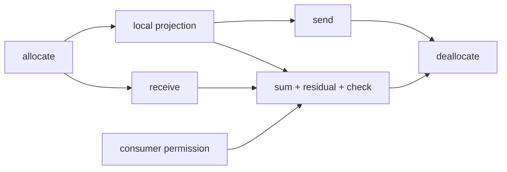

# CPU collectives over HAL TCP channels

This example runs a sharded matrix projection on two to eight CPU workers. Each
worker computes its partition of `X × W`, gathers the other partial results
directly from its peers, and executes an application-written sum and residual
epilogue. All workers check every output against the complete, unsharded
calculation.

The example uses the task HAL and ordinary TCP. It needs no GPU, ROCm, RDMA NIC,
or remote device server. The supported communication route is an explicit
rank group over coherent host memory. Each process owns a local HAL device.

## Run locally

Build the executable and launch three workers:

```sh
build_tools/bin/iree-bazel-build \
  //runtime/src/iree/hal/net/demo:iree-hal-collective-demo
python runtime/src/iree/hal/net/demo/launch.py \
  --binary=bazel-bin/runtime/src/iree/hal/net/demo/iree-hal-collective-demo \
  --count=3 --iterations=8
```

The launcher supplies bound addresses in rank order, forwards worker output,
and joins every worker's final result before allowing group shutdown. Tensor
traffic and request dependencies run directly between workers.

## Run on two machines

Build the executable on each machine, or copy a build compatible with both:

```sh
build_tools/bin/iree-bazel-build \
  //runtime/src/iree/hal/net/demo:iree-hal-collective-demo
```

Start the first worker:

```sh
bazel-bin/runtime/src/iree/hal/net/demo/iree-hal-collective-demo \
  --rank=0 --address=0.0.0.0:7891 --iterations=8
```

After it prints `Listening on ...`, start the second worker with the first
machine's numeric IP address:

```sh
bazel-bin/runtime/src/iree/hal/net/demo/iree-hal-collective-demo \
  --rank=1 --peer_address=FIRST_MACHINE_IP:7891 --iterations=8
```

For two terminals on one machine, use `127.0.0.1:7891` for the first worker's
bind address and the second worker's peer address. Both workers use the same
iteration count. After **both** print `ready_to_close=1`, enter `close` on each
worker's stdin. Closing earlier cancels unfinished group work. An SSH launcher
can run on a third machine: it supplies commands and reads results, while TCP
carries tensor bytes directly between the workers.

Each worker prints checked requests like:

```text
rank=0 request=1 shape=13x48x24 checked=312 checksum=...
...
rank=0 independent_requests=8 held_consumer=pending
rank=0 request=0 shape=8x32x16 checked=128 checksum=...
rank=0 live_tensor_reservations=0 reusable_plans=4
rank=0 ready_to_close=1
Worker verified X*W + residual. All work retired.
```

`shape=MxKxN` means an `M×K` input multiplied by a `K×N` weight matrix. Each
worker computes the terms in `[K*rank/count, K*(rank+1)/count)`, including uneven
partitions. Request zero deliberately holds its final consumer while all eight
other requests complete. The delayed request then checks its
original data, showing that another request can make progress without taking
storage still owned by a consumer. The launch owner joins the final numerical
checks once, at shutdown; it makes no decisions during individual requests.

For larger groups, pass `--count=N` to every worker. Each rank below `N-1`
publishes one listener; rank `r` receives `r` repeated `--peer_address` flags
containing ranks `0` through `r-1` in order. Use numeric addresses reachable by
the workers. Group membership observes failure over a binary tree; each prepared
payload peer also receives a direct connection.

## Memory and execution contract

One shared TLSF workspace suballocates coherent host storage from a reusable
slab cache. Both communication tags, both directions, and both alternating model
shapes use that workspace. The `4*(count-1)` send/receive preparations retain
the pool's access contract and a maximum byte extent. They allocate no tensor ranges.

Each request supplies its current buffer and subrange. Shapes and offsets change
between executions, while the connection, preparations and semaphores stay live.
The request graph is submitted before its allocation or compute completes:



Semaphore edges establish every dependency; submission order provides none.
The send receipt returns the network's source borrow. The receive receipt makes
the peer bytes ready for the local consumer. Deallocation waits for both the
local consumer and the send receipt. It is already queued when the request is
submitted, so storage return needs no additional coordinator decision.

The TCP factory selects `IREE_NET_TCP_RECEIVE_MODE_PLACEMENT`. After receive
dependencies resolve, the channel posts the current destination before sending
its peer a credit. The shared framing engine reads the transport header and
queue coordinate, then gives the native receive operation that destination's
exact address and extent. Tensor bytes travel from the kernel directly into
the application slab: there is no userspace receive copy, whole-message assembly
buffer, or connection-owned tensor receive pool. Ordinary control messages still
use complete-message delivery through the same framing engine.

Ordinary TCP still copies received bytes from kernel socket storage into the
application range. Sends of at least 64 KiB request kernel copy avoidance when
the socket and proactor support it; effective copy avoidance depends on the
platform. The send path borrows the current application range until its native
source-return receipt, independently of the remote consumer's destination
lifetime. This example uses coherent CPU storage throughout.

The worker observes each admitted operation separately. If a peer disappears,
it closes the channel, fails the held consumer's input gate, and joins the actual
local operation receipts before releasing request state and pool owners. A
failed dependent operation alone does not authorize reuse of another operation's
storage.

`worker.c` owns CPU/device setup, shared storage and completion observation.
`main.c` supplies the projection, programmable epilogue and request graph. These
small CPU kernels and output checks are a correctness demonstration, not a GEMM
or network performance benchmark.

## Embedding the channel provider

An application supplies its existing local device, compatible pool and polling
service. `worker.c` shows the cold setup: create a TCP factory in placement mode,
call `iree_hal_net_channel_provider_create`, install the returned provider on
the device, then create a channel with the application's group identity and
rank/count. The provider copies its bind address and lower-rank peer contacts.
`iree_hal_net_channel_query_address`
reports an ephemeral listener's actual address before polling, allowing the
application's bootstrap service to distribute contacts.

Channel creation, transfer preparation and address queries run on the poll
owner. Queue submissions and deactivation may come from other threads. The
application drives the shared proactor through channel deactivation; the provider
creates no progress thread. Group identity, contact exchange and deciding when
all participants have finished remain application responsibilities.

Preparation fixes the compatible pool, peer, tag and maximum extent. Each
prepared transfer admits one exchange at a time; several independent tags form
a bounded window. Every execution names the current range, exact live length
and strictly increasing sequence. Sender and receiver use matching tag,
sequence and length. A receive's waits protect allocation completion and prior
consumers of that range; a send's waits publish its producer's output.

The application observes each accepted operation's own completion and the
channel's deactivation receipt before destroying captured state. Failure of one
dependency wakes its consumers but cannot release another operation's native
borrow. `demo_completion_t` and `demo_worker_close` show those two retirement
boundaries without imposing a per-request coordinator round trip.

## Automated verification

```sh
build_tools/bin/iree-bazel-test --config=asan \
  //runtime/src/iree/hal/net/demo:projection_test
```

The test runs the real executable in two, three and four processes, checks
alternating shapes, matching checksums, the held consumer and zero final tensor
reservations. It also kills each rank after a checked request and requires every
surviving peer to exit with an error after cleanup. Readiness comes from the
bound listener and completed work, with no startup sleeps.
